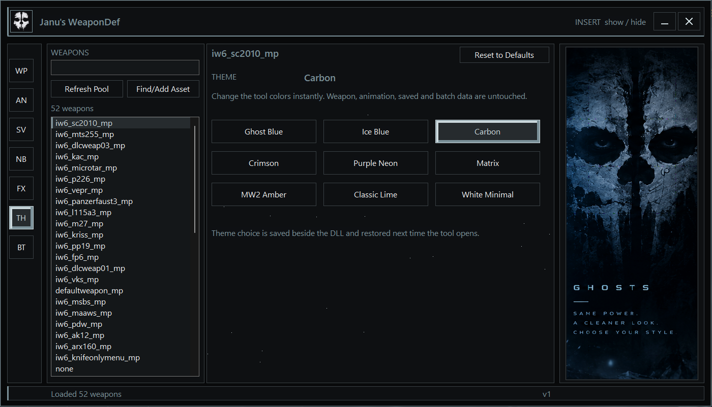
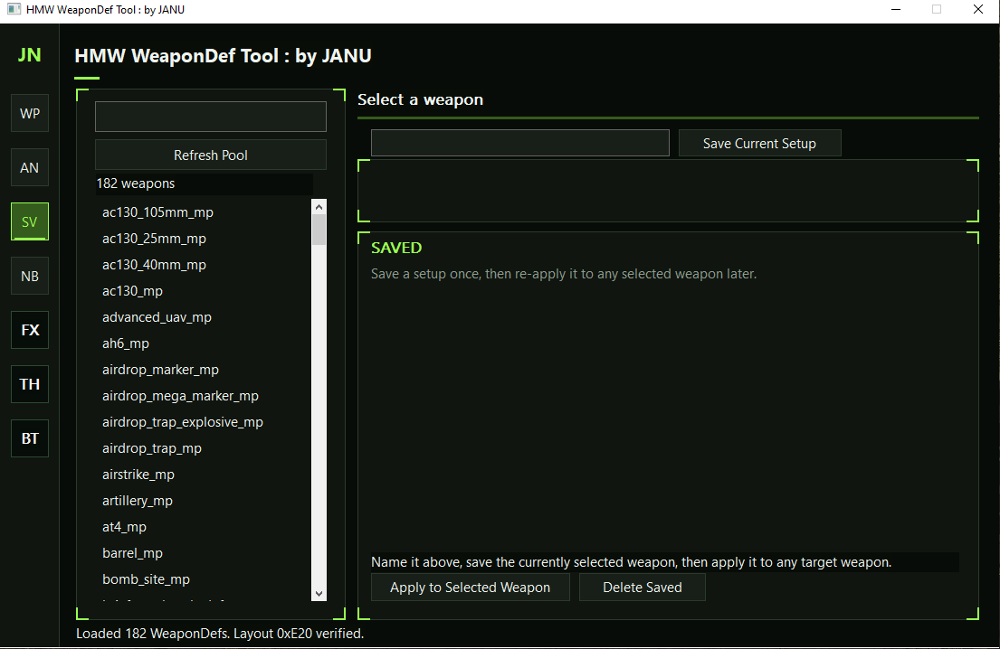
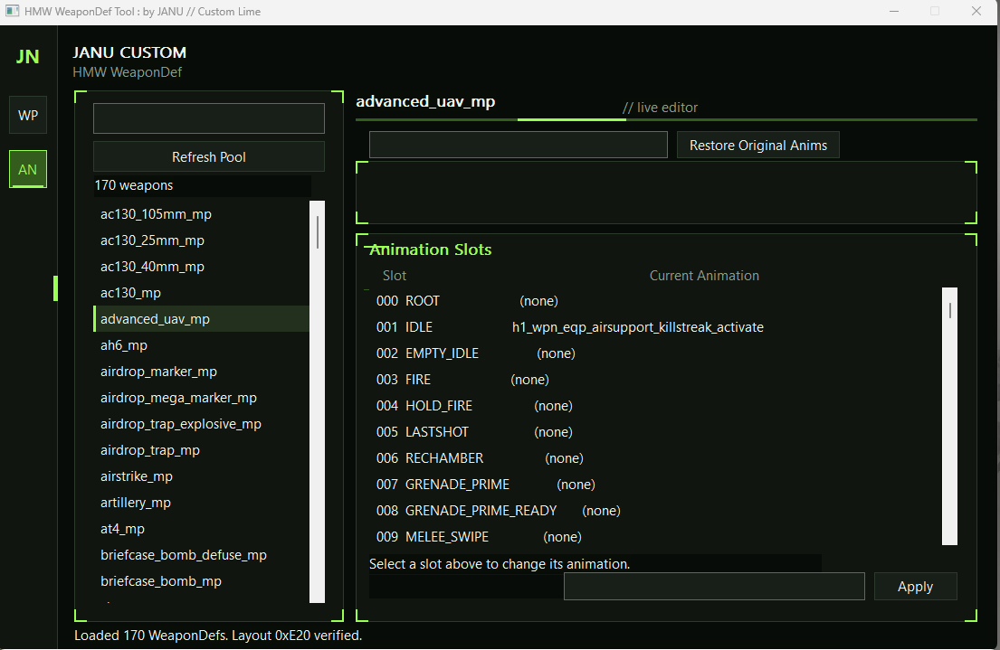

# Janu's WeaponDef

An in-game weapon editor for **IW6x (Call of Duty: Ghosts)**. It's a single DLL you inject while you're in a private match or offline, and it gives you a small window for browsing weapons, editing their WeaponDef values, running animations and saving presets.

### HorizonMW build

## Important

Offline and private matches only. Don't use it on public servers.

## What's in it

- **WP** - weapon list with search, refresh, and add-asset
- **AN** - animations. Applying one also covers the weapon's attachment versions
- **SV** - saved presets, applied to the weapon and its attachment versions
- **NB** - the embedded No Barriers module
- **FX** - background effects for the window
- **TH** - eight colour themes, saved between sessions
- **BT** - batch edits

The window is borderless with its own title bar, remembers where you left it, and **INSERT** shows or hides it.

## Download

- `bin/6x_WeaponDef_by_Janu.dll` - the IW6x build
- `bin/HMW_WeaponDef_by_Janu.dll` - the HorizonMW build. Binary only, its source isn't published.

Close the game before replacing the DLL, since it stays locked while the game is running.

## Building the IW6x version

Open an **x64 Native Tools Command Prompt for VS**, go to `src/`, and run `build.bat`. It builds from a single `.cpp` with no CRT.

## Credits

- Made by **Janu**
- UI and code written with **Claude** (Anthropic)
- The embedded No Barriers module comes from a third-party tool and isn't my work. Credit to its original author.
- Call of Duty: Ghosts and its artwork belong to Activision and Infinity Ward. This is an unofficial fan tool and isn't affiliated with them.
